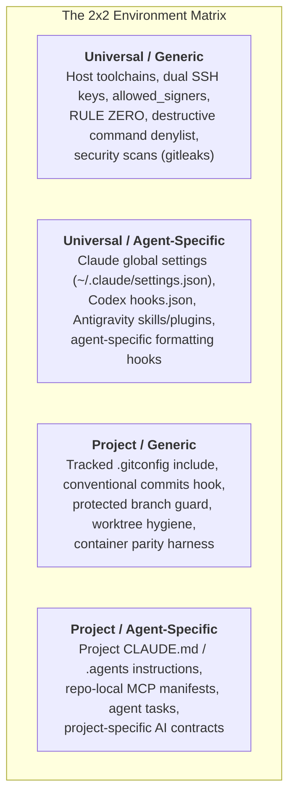
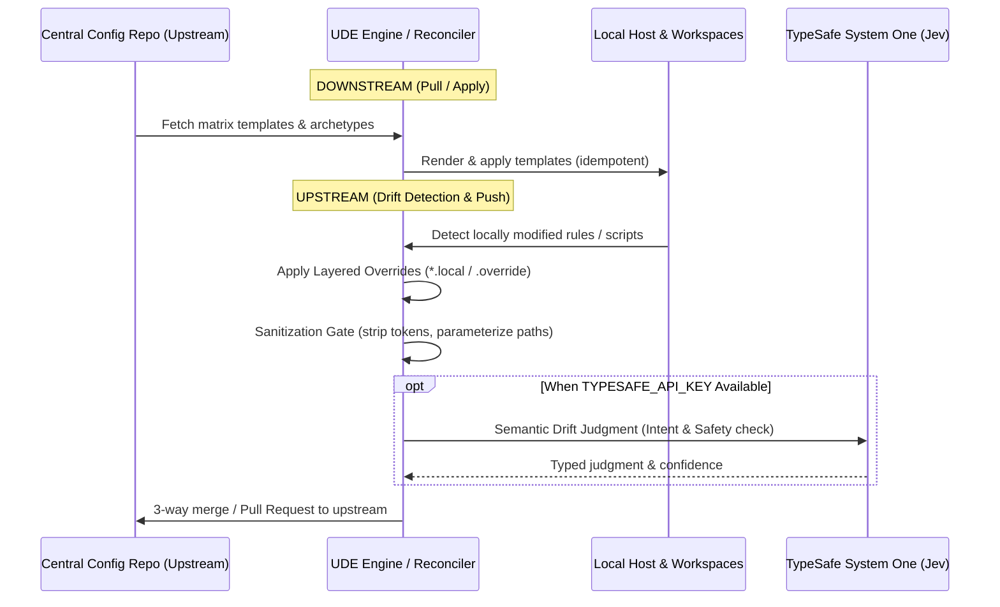
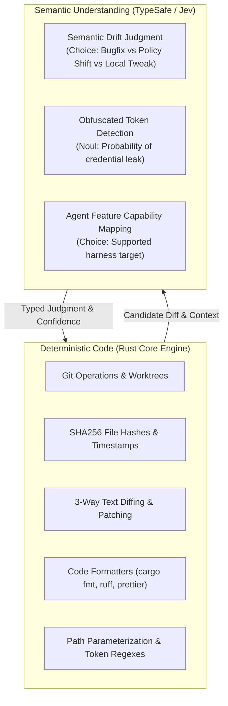

# Universal Development Environment — Architecture & Design Contract

## 1. The Core Taxonomy: The 2x2 Matrix

To make environment configurations modular, auditable, and synchronizable, configuration state is segregated along two independent axes:
1. **Scope Axis:** **Universal (Machine-Global)** vs. **Project-Specific (Repo-Local)**
2. **Actor Axis:** **Agent-Generic (Human & System Baseline)** vs. **Agent-Specific (Tool Harness Adaptations)**

### The Four Quadrants Defined

| Quadrant | Scope | Target Location | Description & Boundary |
|---|---|---|---|
| **Universal / Generic (`UG`)** | Machine-Wide, Tool-Agnostic | `~/.config/git/`, `~/.config/agents/`, `~/.ssh/` | Machine identity, dual-key SSH signing, commit attribution, global secret scanning, canonical RULE ZERO. Must not depend on any specific AI agent binary. |
| **Universal / Agent-Specific (`UA`)** | Machine-Wide, Agent-Tailored | `~/.claude/`, `~/.codex/`, `~/.gemini/` | Agent safety hooks (PreToolUse/PostToolUse), formatting shims (`cargo fmt`, `prettier`), global subagent definitions, and agent rules symlinks pointing back to `UG`. |
| **Project / Generic (`PG`)** | Repo-Local, Tool-Agnostic | `<repo>/.gitconfig`, `<repo>/scripts/hooks/`, `<repo>/.devcontainer/` | Public-safe git-flow branching, chained hooks (`commit-msg`, `pre-commit`, `pre-push`), environment scrubbing, worktree boundary enforcement. Publicly commit-safe. |
| **Project / Agent-Specific (`PA`)** | Repo-Local, Agent-Tailored | `<repo>/.agents/`, `<repo>/CLAUDE.md`, `<repo>/.mcp.json` | Project-specific architecture notes, agent execution tasks (`mise`), local memory stages (`.planning/.mempalace-stage`), and specialized agent instructions. |

---

## 2. Bidirectional Synchronization Architecture

The development environment acts not merely as a one-time template generator, but as a **reconciling state engine** between the central configuration store (upstream) and distributed developer environments / project checkouts (downstream).

### Sync Resolution Model

1. **Default Strategy: Option A (3-Way Merge & Explicit Diff Rejection)**
   - The central upstream git repository is the default source of truth.
   - When `ude sync push` or `ude sync pull` detects divergence:
     - The engine performs a 3-way diff (Ancestor Snapshot vs. Central Upstream vs. Local State).
     - If local and upstream modified the same content orthogonally, changes merge cleanly.
     - If conflicting modifications exist, the engine **refuses silent overwrite**, generates a structured conflict diff, and requires explicit operator resolution.
2. **Override Fallback: Option B (Layered Override Pattern)**
   - For environments or forks that need permanent, un-pushed local adaptations (e.g. host-specific paths, private team instructions), the engine supports the Layered Override pattern.
   - Suffixes like `*.local` (e.g., `CLAUDE.local.md`, `mise.local.toml`) or dedicated override folders (`.ude/overrides/`) are automatically applied on top of the base template during rendering.
   - Layered overrides are permanently excluded from upstream push operations.

---

## 3. Upstream Sanitization Gate & Path Parameterization

Local changes synchronized back to the central repository pass through a **Sanitization Gate**, made of the three checks below. What the gate does and does not promise is stated in the last subsection of this section.

1. **Secret & Credential Scrubbing:**
   - Pre-flight scan rejecting any files containing high-entropy strings, private SSH keys, personal access tokens (`ghp_`, `glpat-`, bearer tokens), or API keys.
2. **Path Parameterization:**
   - The pusher's own home and XDG config paths (for example `/home/alice`, `C:\Users\alice`, `/Users/alice`) are parameterized into portable variables:
     - `{{ user.home }}`
     - `{{ user.xdg_config }}`
   - These are the only placeholders `ude sync push` writes; other machine values (data directories, git identity, other users' paths) are not parameterized.
3. **Publish Boundary Guard:**
   - Projects targeting open-source upstreams enforce contribution boundaries: personal workflow files (`.agents/`, `.planning/`, `scratch/`, `mise.local.toml`) cannot leak into upstream commits or PRs.

### What the publication gate promises

**Scope.** Code running in the cache checkout (a hook, including one that global or system `core.hooksPath` names; a filter; a config-defined command; or a process one of them left) writing state in that checkout's own repository (`.git`: hooks, config, refs, index, objects, info, shallow) while `ude sync push` runs through `ensure_remote_repo_for_push` and `push_to_remote`. Global and system git config is outside this scope except where a row below names a key of it.

**What was run.** Every test named below runs against a remote reached by a local path or file URL, with git 2.56.0 on Linux. NOT-12 lists what was not run; not run is not the same as not defended.

**The promises, within that scope.**

1. What is sent: UDE's push sends the validated commit: exactly one commit on the remote's head as read from outside the checkout, whose tree is the tree UDE staged, whose message is the sync message, and whose changed blobs are the validated bytes, and no object outside it; apart from two cases pending the operator (NOT-10): a `.git/shallow` file written after the gate, and a loose object file overwritten during the push after the gate read it.
2. What Ok means: Ok after a push means the caller's URL, read from outside the checkout, reports the target ref at that commit. Ok with nothing to push means the head read that way holds every recorded path and none of the deleted ones.
3. What a refusal prints: the committed gate's refusals print no bytes a hook chose, apart from a failed git command's stderr excerpt (NOT-09).

| ID | Channel | What happens | Tests |
|----|---------|--------------|-------|
| DEF-01 | Any local ref named after the commit id: refs/tags/`<id>`, refs/heads/`<id>`, refs/remotes/`<id>`, refs/`<id>`, a ref file spelled `<id>^{commit}`, pointing at any commit, whether a hook or a filter made it | The source is `<id>^{commit}`, which no ref name can hold; the remote tip is the validated commit; the ref's commit stays home | test_direct_push_ignores_tag_named_after_the_commit test_pr_push_ignores_tag_named_after_the_commit test_direct_push_ignores_branch_named_after_the_commit test_pr_push_ignores_branch_named_after_the_commit test_direct_push_ignores_remote_ref_named_after_the_commit test_pr_push_ignores_remote_ref_named_after_the_commit test_direct_push_ignores_top_level_ref_named_after_the_commit test_pr_push_ignores_top_level_ref_named_after_the_commit test_direct_push_ignores_ref_file_spelled_like_the_source test_direct_push_ignores_token_behind_shadow_ref test_pr_push_ignores_token_behind_shadow_ref test_direct_push_ignores_duplicate_tree_behind_shadow_ref test_pr_push_ignores_duplicate_tree_behind_shadow_ref test_direct_push_ignores_dot_tree_behind_shadow_ref test_pr_push_ignores_dot_tree_behind_shadow_ref test_direct_push_ignores_deleted_file_behind_shadow_ref test_pr_push_ignores_deleted_file_behind_shadow_ref test_direct_push_ignores_reverted_file_behind_shadow_ref test_pr_push_ignores_reverted_file_behind_shadow_ref test_direct_push_ignores_amended_message_behind_shadow_ref test_pr_push_ignores_amended_message_behind_shadow_ref test_direct_push_ignores_shadow_ref_left_by_clean_filter test_pr_push_ignores_shadow_ref_left_by_clean_filter test_cli_direct_push_ignores_tag_named_after_the_commit test_cli_pr_push_ignores_tag_named_after_the_commit |
| DEF-02 | Replace refs written before the gate: on the commit (parentless, to a tag), a blob, a tree or a message; on the fetched head's tree, which empties `git status` through ensure's `reset --hard` | Every gate read and the push run past replace refs; the validated commit publishes or the gate refuses | test_direct_push_publishes_validated_commit_past_replace_ref test_pr_push_publishes_validated_commit_past_replace_ref test_direct_push_ignores_replace_ref_to_a_tag test_pr_push_ignores_replace_ref_to_a_tag test_push_refuses_hook_replaced_blob test_push_refuses_hook_merge_replaced_by_validated_commit test_push_refuses_hook_replaced_tree test_push_refuses_hook_replaced_message test_push_refuses_hook_replaced_tree_hiding_empty_directory test_committed_gate_reads_blob_past_replace_ref test_direct_push_no_changes_refuses_replace_ref_on_the_fetched_tree test_pr_push_no_changes_refuses_replace_ref_on_the_fetched_tree |
| DEF-03 | The sync branch or HEAD moved after the id was read | The id is pushed, not a ref | test_pr_push_publishes_the_validated_commit_not_the_branch_tip |
| DEF-04 | Tags following the push through `push.followTags` | `--no-follow-tags` on both pushes | test_direct_push_does_not_publish_hook_tag test_pr_push_does_not_publish_hook_tag |
| DEF-05 | Objects outside the commit through push's object walk: a grafts file present at the gate, written by a pre-push hook, or written during the push; a forged commit-graph (local, split, alternate); a bitmap (pack, multi-pack index) built under a graft; an inherited GIT_TEST_* variable. `.git/shallow` written after the gate is NOT-10 | Refused on presence at the gate; the push reads the null device and has graphs and bitmaps off | test_direct_push_refuses_hook_grafts_file test_pr_push_refuses_hook_grafts_file test_refuse_grafts_file_outcomes test_direct_push_sends_no_object_from_pre_push_grafts test_pr_push_sends_no_object_from_pre_push_grafts test_direct_push_sends_no_object_from_grafts_written_during_push test_pr_push_sends_no_object_from_grafts_written_during_push test_direct_push_sends_no_object_from_forged_commit_graph test_pr_push_sends_no_object_from_forged_commit_graph test_push_sends_no_object_from_forged_split_commit_graph test_push_sends_no_object_from_forged_alternate_commit_graph test_direct_push_sends_no_object_from_graft_built_bitmap test_pr_push_sends_no_object_from_graft_built_bitmap test_push_sends_no_object_from_graft_built_multi_pack_index_bitmap test_direct_push_ignores_inherited_git_test_commit_graph test_pr_push_ignores_inherited_git_test_commit_graph test_remove_git_test_env test_run_bounded_ignoring_grafts_sets_the_null_device test_cli_direct_push_alone_gets_the_null_grafts_file test_cli_pr_push_alone_gets_the_null_grafts_file |
| DEF-06 | A fetched head that is not the remote's head, by any cause in the checkout: a moved tracking ref (post-checkout on the cached path, global core.hooksPath on the clone path, reference-transaction, clean or smudge filter), `remote.origin.fetch` keeping a moved ref, `remote.origin.url` or repository-level `url.*.insteadOf` on the fetch, a tag named origin/`<branch>` | The push refuses before staging; a real move during the fetch says to pull first; a move after the fetch is the push's own fast-forward refusal | test_direct_push_refuses_tracking_ref_moved_by_post_checkout_hook test_pr_push_refuses_tracking_ref_moved_by_post_checkout_hook test_direct_push_refuses_token_on_moved_tracking_ref test_pr_push_refuses_token_on_moved_tracking_ref test_direct_push_refuses_tracking_ref_moved_on_clone_path test_pr_push_refuses_tracking_ref_moved_on_clone_path test_direct_push_refuses_tracking_ref_moved_by_reference_transaction_hook test_pr_push_refuses_tracking_ref_moved_by_reference_transaction_hook test_direct_push_refuses_tracking_ref_kept_by_hook_written_fetch_config test_pr_push_refuses_tracking_ref_kept_by_hook_written_fetch_config test_direct_push_refuses_fetch_redirected_by_hook_written_origin_url test_pr_push_refuses_fetch_redirected_by_hook_written_origin_url test_direct_push_refuses_fetch_redirected_by_hook_written_instead_of test_pr_push_refuses_fetch_redirected_by_hook_written_instead_of test_direct_push_refuses_tracking_ref_moved_by_clean_filter test_pr_push_refuses_tracking_ref_moved_by_clean_filter test_direct_push_refuses_tracking_ref_moved_by_smudge_filter test_pr_push_refuses_tracking_ref_moved_by_smudge_filter test_push_refuses_tag_named_after_the_tracking_ref test_ensure_for_push_reports_real_upstream_move_as_upstream_moved test_remote_head test_remote_head_ignores_repository_config test_cli_direct_push_refuses_tracking_ref_moved_by_post_checkout_hook test_cli_pr_push_refuses_tracking_ref_moved_by_post_checkout_hook test_cli_direct_push_refuses_tracking_ref_moved_on_clone_path test_cli_pr_push_refuses_tracking_ref_moved_on_clone_path test_cli_direct_push_reports_upstream_moved_during_fetch test_force_does_not_bypass_upstream_moved test_direct_push_aborts_when_upstream_moved |
| DEF-07 | The commit's shape: a merge, an added commit, a parentless commit, HEAD moved to another commit | Exactly one commit whose only parent is the fetched head, read raw | test_direct_push_refuses_hook_merge_over_amended_commit test_pr_push_refuses_hook_merge_over_amended_commit test_direct_push_refuses_hook_added_commit test_pr_push_refuses_hook_added_commit test_pr_push_refuses_hook_parentless_commit test_push_continuity_violation_is_hard_failure test_raw_commit_parents test_committed_gate_compares_full_object_ids test_post_commit_hook_rewrite_is_refused |
| DEF-08 | Commit text: a rewritten message, a secret the scanner flags in the header | The message is bound byte for byte; the header is scanned and a flagged secret refuses | test_committed_gate_requires_exact_sync_message test_direct_push_refuses_prepare_commit_msg_hook_text test_pr_push_refuses_prepare_commit_msg_hook_text test_direct_push_refuses_hook_amended_message test_pr_push_refuses_hook_amended_message test_push_refuses_hook_secret_in_commit_header |
| DEF-09 | The tree after staging: another tree id, an exec flip after the id is recorded, a repeated entry or directory, a component that is empty, `.` or `..`, an added file, an empty directory, a symlink, a tag at a file's place; a tree of the fetched head or of the commit in the cache checkout whose stored bytes do not match its object id, so an added, changed or deleted path is missing from the changes the gate checks | The tree id is bound to the staged tree; the listing is read raw and refuses these; the listing and the changes from the fetched head are built only from tree bytes that hash to their ids in the checkout's object format | test_committed_gate_requires_the_staged_tree test_stage_publication_records_the_staged_tree test_stage_publication_refuses_when_the_tree_cannot_be_recorded test_direct_push_refuses_hook_exec_flip test_pr_push_refuses_hook_exec_flip test_direct_push_refuses_hook_duplicate_entry test_pr_push_refuses_hook_duplicate_entry test_direct_push_refuses_hook_duplicate_token_entry test_pr_push_refuses_hook_duplicate_token_entry test_direct_push_refuses_hook_duplicate_directory test_pr_push_refuses_hook_duplicate_directory test_direct_push_refuses_hook_repeated_same_blob test_pr_push_refuses_hook_repeated_same_blob test_direct_push_refuses_index_hook_repeated_same_blob test_pr_push_refuses_index_hook_repeated_same_blob test_direct_push_refuses_hook_dot_subtree test_pr_push_refuses_hook_dot_subtree test_tree_listing_blobs prop_tree_listing_blobs_round_trips test_committed_gate_refuses_bad_path_components test_push_refuses_hook_added_file test_push_refuses_hook_empty_directory test_push_refuses_index_hook_empty_directory test_push_refuses_index_hook_symlink test_committed_gate_refuses_tag_object_at_validated_path test_direct_push_refuses_index_swap_to_tag_object test_pr_push_refuses_index_swap_to_tag_object test_push_refuses_index_swap_to_injected_blob test_direct_push_refuses_added_file_hidden_by_base_tree_not_matching_its_id test_pr_push_refuses_added_file_hidden_by_base_tree_not_matching_its_id test_committed_gate_refuses_base_tree_not_matching_its_id test_listing_diff test_listing_diff_matches_diff_tree test_parse_tree_object test_verified_tree_listing_matches_ls_tree |
| DEF-10 | Blob bytes up to the gate's read: a filter or hook rewriting a blob before the gate reads it, a blob hidden behind a repeated entry, a secret the scanner flags in a committed blob | Each changed blob is read by id, scanned, and compared with the record; a flagged secret rolls the commit back | test_direct_push_refuses_index_hook_hidden_blob test_pr_push_refuses_index_hook_hidden_blob test_direct_push_refuses_index_hook_hidden_token test_pr_push_refuses_index_hook_hidden_token test_direct_push_refuses_rewriting_clean_filter test_pr_push_refuses_rewriting_clean_filter test_publication_gate_refuses_blob_changed_by_clean_filter test_publication_gate_scans_staged_blob_rejecting_clean_filter_secrets test_post_commit_verification_catches_hook_injected_secrets_and_rolls_back test_post_commit_gate_scans_raw_blob_bytes test_post_commit_gate_blocks_gitleaks_only_category test_raw_diff_entries prop_raw_diff_entries_round_trips |
| DEF-11 | A recorded path missing or reverted in the commit; a blob in the cache checkout that the gate reads for a recorded path, changed or not, or a tree above an unchanged recorded path, whose stored bytes do not match its object id, so the record reads as held while the remote holds other bytes; such an object file swapped between two of the gate's reads; a commit to publish whose stored bytes do not match its object id | Every recorded path must hold its recorded content, and the commit, each tree from the root down and each blob read for it must hash to its id in the checkout's object format, with every decision taken from the bytes that were hashed, or the push refuses; a refusal names only a recorded or allowlisted path | test_direct_push_refuses_hook_deleted_file test_pr_push_refuses_hook_deleted_file test_direct_push_refuses_hook_reverted_file test_pr_push_refuses_hook_reverted_file test_direct_push_refuses_index_hook_removed_file test_pr_push_refuses_index_hook_removed_file test_committed_gate_requires_validated_content test_committed_gate_requires_validated_content_refuses_tag_object test_direct_push_refuses_unchanged_blob_not_matching_its_id test_pr_push_refuses_unchanged_blob_not_matching_its_id test_direct_push_refuses_unchanged_subtree_not_matching_its_id test_pr_push_refuses_unchanged_subtree_not_matching_its_id test_committed_gate_refuses_changed_blob_not_matching_its_id test_read_verified_object_checks_bytes_against_the_id test_read_verified_object_in_sha256_repository test_read_verified_object_refuses_an_abbreviated_id test_direct_push_refuses_unchanged_subtree_rewritten_only_while_listed test_pr_push_refuses_unchanged_subtree_rewritten_only_while_listed test_committed_gate_refuses_commit_not_matching_its_id |
| DEF-12 | Ok with nothing to push: anything that empties `git status` (an index flag, a replace ref, by any trick) while the record is not on the fetched head; HEAD off the fetched head; a deleted path still present; a blob or tree of the fetched head in the cache checkout whose stored bytes do not match its object id, so the record reads as held or a deleted path as gone; such an object file swapped between two of the gate's reads | Refused, unless HEAD is the fetched head, that tree lists no path twice and holds the record, deleted paths are gone, and each tree from the root down and each blob read for a recorded path hashes to its id in the checkout's object format, with every decision taken from the bytes that were hashed; git status also refuses a root tree that does not, before the gate | test_direct_push_refuses_assume_unchanged_set_during_ensure test_pr_push_refuses_assume_unchanged_set_during_ensure test_direct_push_no_changes_refuses_replace_ref_on_the_fetched_tree test_pr_push_no_changes_refuses_replace_ref_on_the_fetched_tree test_direct_push_refuses_assume_unchanged_set_after_ensure test_pr_push_refuses_assume_unchanged_set_after_ensure test_direct_push_no_changes_refuses_head_off_the_fetched_head test_pr_push_no_changes_refuses_head_off_the_fetched_head test_direct_push_no_changes_refuses_deleted_path_still_held test_pr_push_no_changes_refuses_deleted_path_still_held test_direct_push_no_changes_publishes_nothing_when_content_is_held test_pr_push_no_changes_publishes_nothing_when_content_is_held test_cli_direct_push_refuses_index_flag_and_keeps_state test_cli_pr_push_refuses_index_flag_and_keeps_state test_direct_push_no_changes_refuses_blob_not_matching_its_id test_pr_push_no_changes_refuses_blob_not_matching_its_id test_direct_push_no_changes_refuses_subtree_not_matching_its_id test_pr_push_no_changes_refuses_subtree_not_matching_its_id test_direct_push_no_changes_refuses_subtree_hiding_a_deleted_path test_pr_push_no_changes_refuses_subtree_hiding_a_deleted_path test_direct_push_refuses_fetched_root_tree_not_matching_its_id test_pr_push_refuses_fetched_root_tree_not_matching_its_id test_direct_push_no_changes_refuses_subtree_rewritten_only_while_listed test_pr_push_no_changes_refuses_subtree_rewritten_only_while_listed test_direct_push_no_changes_refuses_deletion_hidden_only_while_listed test_pr_push_no_changes_refuses_deletion_hidden_only_while_listed test_fetched_head_holds_refuses_root_tree_not_matching_its_id |
| DEF-13 | Ok after a push whose destination was redirected, by any key in the checkout's config: `remote.origin.pushurl` (no longer read), `url.*.pushInsteadOf`, `url.*.insteadOf` after the fetch, `remote.<url>.pushurl`, a hook or a filter writing them; by global or system `url.*.pushInsteadOf`, which the read does not follow (measured); or the ref moving on before the read | The caller's URL, read from the filesystem root, must report the ref at the commit, or the push refuses and records no ancestor | test_direct_push_ignores_hook_written_origin_pushurl test_pr_push_ignores_hook_written_origin_pushurl test_direct_push_refuses_hook_written_push_instead_of test_pr_push_refuses_hook_written_push_instead_of test_direct_push_refuses_global_push_instead_of test_pr_push_refuses_global_push_instead_of test_direct_push_refuses_hook_written_instead_of_after_the_fetch test_pr_push_refuses_hook_written_instead_of_after_the_fetch test_direct_push_refuses_hook_written_url_keyed_pushurl test_pr_push_refuses_hook_written_url_keyed_pushurl test_direct_push_refuses_redirect_written_by_clean_filter test_pr_push_refuses_redirect_written_by_clean_filter test_direct_push_refuses_when_remote_branch_moved_after_push test_pr_push_refuses_when_remote_branch_moved_after_push test_confirm_published test_cli_direct_push_ignores_hook_written_origin_pushurl test_cli_pr_push_ignores_hook_written_origin_pushurl test_cli_direct_push_refuses_hook_written_push_instead_of test_cli_pr_push_refuses_hook_written_push_instead_of test_cli_direct_push_reads_the_remote_twice_from_outside_the_checkout test_cli_pr_push_reads_the_remote_twice_from_outside_the_checkout |
| DEF-14 | The committed gate's refusal text: the raw `parent` line of a hook-built commit, a listed path name. A failed git command's stderr excerpt inside a refusal is NOT-09 | Fixed text, the fetched head's id and paths on the allowlist only | test_direct_push_refusal_omits_hook_text_in_parent_line test_pr_push_refusal_omits_hook_text_in_parent_line test_direct_push_refusal_omits_token_in_parent_line test_pr_push_refusal_omits_token_in_parent_line test_cli_direct_push_refusal_prints_no_hook_bytes test_cli_pr_push_refusal_prints_no_hook_bytes test_push_refuses_hook_replaced_tree |
| DEF-15 | Not over-refusing: hooks keep running; a hook or filter that leaves the parent, the tree, the message and the changed blob bytes as validated publishes; with no hook, a push over a fetched head whose tree lists no path twice publishes | Published, or refused for a secret the scanner flags | test_direct_push_publishes_with_benign_post_commit_hook test_pr_push_publishes_with_benign_post_commit_hook test_direct_push_publishes_with_benign_pre_push_hook test_pr_push_publishes_with_benign_pre_push_hook test_direct_push_publishes_with_benign_prepare_commit_msg_hook test_pr_push_publishes_with_benign_prepare_commit_msg_hook test_direct_push_publishes_with_content_kept_amend test_pr_push_publishes_with_content_kept_amend test_pr_push_publishes_with_benign_post_checkout_hook test_direct_push_with_head_check_publishes_with_benign_post_checkout_hook test_pr_push_with_head_check_publishes_with_benign_post_checkout_hook test_direct_push_publishes_with_pass_through_clean_filter test_pr_push_publishes_with_pass_through_clean_filter test_push_from_clone_of_gc_remote_publishes test_direct_push_publishes_with_hook_commit_and_no_grafts_file test_push_publishes_with_index_swap_to_the_staged_tree test_cli_direct_push_publishes_benign_edit_with_no_hook test_cli_direct_push_with_post_commit_hook_and_no_shadow_ref_publishes test_cli_direct_push_with_noop_index_hook_publishes test_cli_direct_push_refuses_token_line_with_no_hook test_cli_direct_push_refuses_high_entropy_line_with_no_hook test_cli_push_with_relative_remote_path_publishes |

| ID | Not defended | Reason and status |
|----|--------------|-------------------|
| NOT-01 | Code in the checkout running its own `git push`, `curl` or anything else with the user's credentials | The gate governs UDE's push. The reasoning that such code can already push anything with the user's credentials stands for this and only this: the operator ruled on 2026-11-02 that it does not extend to UDE's own push |
| NOT-02 | Global or system git config keys that redirect the read or the push: `url.*.insteadOf`, `url.*.pushInsteadOf`, `remote.<url>.url`, `remote.<url>.pushurl`, `core.sshCommand`, `http.proxy` and any other such key, also in a file that `GIT_CONFIG_GLOBAL` in UDE's environment names. What they deliver to another repository, and an Ok where the read follows the key as the push does | Accepted by the operator: the residual recorded on 2026-11-02 for `url.*.insteadOf`, widened on 2026-11-03 to every global redirect key, with the promise kept to the cache checkout and its hooks. Measured with plain git: global `url.*.insteadOf` makes `git ls-remote` run from `/` report the other repository; global `remote.<url>.url` does the same for a `file://` URL (git refuses a path starting with `/` as a remote name, with a warning, and reads the real repository); global `url.*.pushInsteadOf` moves the push and not the read, so that push gets no Ok (DEF-13). Reasoned, not run: UDE's push end to end under global `remote.<url>.url` |
| NOT-03 | Anything else written outside the cache checkout's repository: the `git` on PATH, the `ude` binary, UDE's config, the project's own files, and global or system git config other than its redirect keys (NOT-02). Hooks and filters that global config names run in the checkout and are in scope (the clone-path tests of DEF-06 use global `core.hooksPath`) | Outside the scope the operator kept on 2026-11-03: the promise covers the cache checkout and its hooks. Project files are scanned when push_updates reads them. Not run |
| NOT-04 | Delivery of the validated commit to a redirected repository before the read-back refuses, by keys in the checkout's config: `url.*.pushInsteadOf`, `url.*.insteadOf`, `remote.<url>.pushurl`, also `core.sshCommand` or `http.proxy` | No Ok, and only validated bytes travel. The first three were run; the last two are reasoned. Accepted by the operator on 2026-11-03, for every key in this row |
| NOT-05 | Credentials: a hook-written `credential.helper`, `core.askPass` or `http.extraHeader` | A hook can ask `git credential fill` itself. Not run |
| NOT-06 | A secret the scanner does not flag, in a blob or in the commit header | The scanner's measured limits: the entropy check never flags hex-only or single-case secrets, and lets through about 3 to 7% of random mixed-case keys and 18 to 23% of base36 keys; most vendored rules have no behavioural fixture; the commit header is scanned, not bound to validated bytes |
| NOT-07 | `push.pushOption` text reaching the remote's hooks | No object travels. Open |
| NOT-08 | Which repository `gh pr create` opens the PR in: it reads the checkout's remote config | The branch was confirmed at the caller's URL first. Not run: no `gh` against a real host here |
| NOT-09 | Bytes in the stderr excerpt of a git command that failed, including a hook's own text and control bytes; name-bearing refusals of the staged gate | Measured: a pre-push hook printing to stderr and exiting 1 reaches the terminal, with its ESC byte, through `with_excerpt`. A hook can write to the terminal itself, and the excerpt is how a remote's refusal reaches the user. The staged gate's refusals are open |
| NOT-10 | A file mode set before the tree id is recorded publishes (test_index_hook_exec_flip_reaches_the_remote pins it); the binding refuses every push when a hook changes only a file mode, and every push from an existing cache whose fetched head already lists a path twice in a subtree the push does not change; `.git/shallow` written after the gate; a loose object file overwritten during the push, after the gate read it; `NUL` on Windows | Pending the operator |
| NOT-11 | `ude sync status` and `ude sync pull`: no head check, so a hook in the cache can make a local pull write its content into this machine's project | The extra read was accepted per push only. Nothing reaches the remote. Not run in this form |
| NOT-12 | Not run here: a hosted remote, https, ssh, Windows, and a server that skips its connectivity check | Unreachable here, so no test ran on them. This row records missing runs, not undefended channels: a DEF row's outcome failing on one of them is a defect against that row |
| NOT-13 | Anything after the read-back returns: another publisher moving the ref, a host rewriting history | Ok says what the remote reported when read |
| NOT-14 | Availability: a hook that always changes the tree or the message makes every push refuse; failure paths leaving a local branch or commit behind | Fail closed by design; the second is open |
| NOT-15 | A token-bearing URL on argv for each push and read, where it was on argv only at the first clone | Accepted by the operator on 2026-11-03. Text UDE prints still has the userinfo redacted |

**Classifying a later finding.** Each finding gets exactly one of three outcomes. (1) It names a channel in a DEF row, shows that row's outcome failing on any transport or platform, and fits no NOT row: a defect, which re-opens that row. A class row holds for every instance of its class, so a new instance of DEF-01, DEF-06, DEF-12 or DEF-13 that fits no NOT row is a defect, not new scope. (2) It names a channel and outcome in a NOT row and fits no DEF row's failing outcome: not a finding; the row's status stands until the operator changes it. NOT-12 records runs that do not exist, so it never decides a finding under (2) and never stops one under (1). (3) Anything (1) and (2) do not decide goes to the operator: a finding that names neither kind of row, or one that fits both a DEF row and a NOT row, a new instance of a class row included. Record it and ask the operator whether it joins the DEF rows or the NOT rows, or which of the two rows holds. It re-opens nothing, and it does not join either list by default.

---

## 4. Semantic Intelligence: TypeSafe System One Integration

UDE distinguishes between **deterministic code execution** (which must remain fast, predictable, and local) and **semantic judgments** (where semantic understanding is needed).

### The Three TypeSafe Primitives in UDE

1. **Semantic Drift Classifier (`Choice` primitive):**
   - **Instruction:** Evaluates local edits made to prompt/rule markdown files.
   - **Criteria:** Categorizes drift into:
     - `benign_rephrase`: Stylistic improvement or typo fix (safe to auto-propose upstream).
     - `project_exception`: Repository-specific constraint (recommend routing to `Option B: .local`).
     - `policy_shift`: Fundamental change to core rules like RULE ZERO (requires explicit maintainer sign-off).
2. **Deep Secret Screening (`Noul` primitive):**
   - Complements rigid regex scans by evaluating whether an unflagged suspicious string in a staged rule represents a live secret/credential versus dummy documentation example.
3. **Graceful Fallback:**
   - TypeSafe integration is strictly additive. When `TYPESAFE_API_KEY` is not present, UDE falls back directly to deterministic AST/regex guards and standard 3-way diffing.
