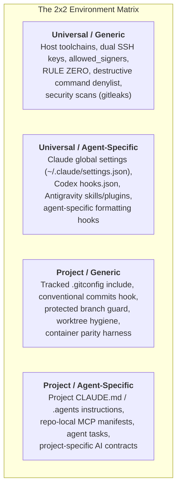
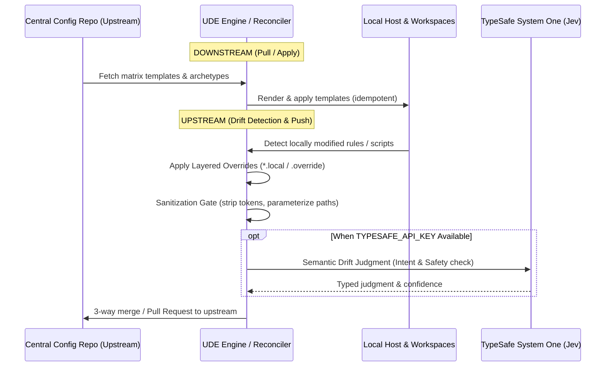
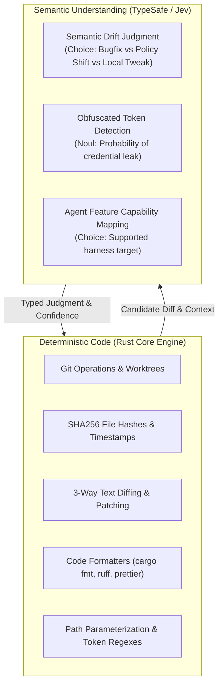

# Universal Development Environment — Architecture & Design Contract

## 1. The Core Taxonomy: The 2x2 Matrix

To make environment configurations modular, auditable, and synchronizable, configuration state is segregated along two independent axes:
1. **Scope Axis:** **Universal (Machine-Global)** vs. **Project-Specific (Repo-Local)**
2. **Actor Axis:** **Agent-Generic (Human & System Baseline)** vs. **Agent-Specific (Tool Harness Adaptations)**

### The Four Quadrants Defined

| Quadrant | Scope | Target Location | Description & Boundary |
|---|---|---|---|
| **Universal / Generic (`UG`)** | Machine-Wide, Tool-Agnostic | `~/.config/git/`, `~/.config/agents/`, `~/.ssh/` | Machine identity, dual-key SSH signing, commit attribution, global secret scanning, canonical RULE ZERO. Must not depend on any specific AI agent binary. |
| **Universal / Agent-Specific (`UA`)** | Machine-Wide, Agent-Tailored | `~/.claude/`, `~/.codex/`, `~/.gemini/` | Agent safety hooks (PreToolUse/PostToolUse), formatting shims (`cargo fmt`, `prettier`), global subagent definitions, and agent rules symlinks pointing back to `UG`. |
| **Project / Generic (`PG`)** | Repo-Local, Tool-Agnostic | `<repo>/.gitconfig`, `<repo>/scripts/hooks/`, `<repo>/.devcontainer/` | Public-safe git-flow branching, chained hooks (`commit-msg`, `pre-commit`, `pre-push`), environment scrubbing, worktree boundary enforcement. Publicly commit-safe. |
| **Project / Agent-Specific (`PA`)** | Repo-Local, Agent-Tailored | `<repo>/.agents/`, `<repo>/CLAUDE.md`, `<repo>/.mcp.json` | Project-specific architecture notes, agent execution tasks (`mise`), local memory stages (`.planning/.mempalace-stage`), and specialized agent instructions. |

---

## 2. Bidirectional Synchronization Architecture

The development environment acts not merely as a one-time template generator, but as a **reconciling state engine** between the central configuration store (upstream) and distributed developer environments / project checkouts (downstream).

### Sync Resolution Model

1. **Default Strategy: Option A (3-Way Merge & Explicit Diff Rejection)**
   - The central upstream git repository is the default source of truth.
   - When `ude sync push` or `ude sync pull` detects divergence:
     - The engine performs a 3-way diff (Ancestor Snapshot vs. Central Upstream vs. Local State).
     - If local and upstream modified the same content orthogonally, changes merge cleanly.
     - If conflicting modifications exist, the engine **refuses silent overwrite**, generates a structured conflict diff, and requires explicit operator resolution.
2. **Override Fallback: Option B (Layered Override Pattern)**
   - For environments or forks that need permanent, un-pushed local adaptations (e.g. host-specific paths, private team instructions), the engine supports the Layered Override pattern.
   - Suffixes like `*.local` (e.g., `CLAUDE.local.md`, `mise.local.toml`) or dedicated override folders (`.ude/overrides/`) are automatically applied on top of the base template during rendering.
   - Layered overrides are permanently excluded from upstream push operations.

---

## 3. Upstream Sanitization Gate & Path Parameterization

To guarantee that local changes can be synchronized back to the central repository without risk of credential leakage or machine path corruption, every upstream sync must pass through a strict **Sanitization Gate**:

1. **Secret & Credential Scrubbing:**
   - Pre-flight scan rejecting any files containing high-entropy strings, private SSH keys, personal access tokens (`ghp_`, `glpat-`, bearer tokens), or API keys.
2. **Path Parameterization:**
   - Machine-specific absolute paths (`/var/home/denniyahh`, `C:\Users\username`, `/Users/username`) are automatically parameterized into portable variables:
     - `{{ user.home }}`
     - `{{ xdg.config }}`
     - `{{ xdg.data }}`
     - `{{ git.email }}`
3. **Publish Boundary Guard:**
   - Projects targeting open-source upstreams enforce contribution boundaries: personal workflow files (`.agents/`, `.planning/`, `scratch/`, `mise.local.toml`) cannot leak into upstream commits or PRs.

---

## 4. Semantic Intelligence: TypeSafe System One Integration

UDE distinguishes between **deterministic code execution** (which must remain fast, predictable, and local) and **semantic judgments** (where semantic understanding is needed).

### The Three TypeSafe Primitives in UDE

1. **Semantic Drift Classifier (`Choice` primitive):**
   - **Instruction:** Evaluates local edits made to prompt/rule markdown files.
   - **Criteria:** Categorizes drift into:
     - `benign_rephrase`: Stylistic improvement or typo fix (safe to auto-propose upstream).
     - `project_exception`: Repository-specific constraint (recommend routing to `Option B: .local`).
     - `policy_shift`: Fundamental change to core rules like RULE ZERO (requires explicit maintainer sign-off).
2. **Deep Secret Screening (`Noul` primitive):**
   - Complements rigid regex scans by evaluating whether an unflagged suspicious string in a staged rule represents a live secret/credential versus dummy documentation example.
3. **Graceful Fallback:**
   - TypeSafe integration is strictly additive. When `TYPESAFE_API_KEY` is not present, UDE falls back directly to deterministic AST/regex guards and standard 3-way diffing.
