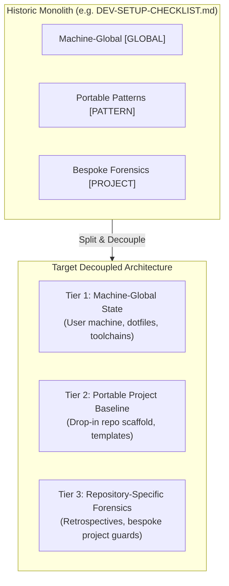

# Universal Development Environment — Architecture & Design Contract

## 1. The Problem: Conflation of Three Layers

Historically, development environment documentation and automation suffered from conflating three distinct layers of state into monolithic checklists:

When these three are mixed:
1. **New projects cannot be bootstrapped quickly:** An engineer or agent trying to set up a new project must untangle which parts are universal and which parts are specific to a prior project's historical bugs.
2. **Global drift goes undetected:** Machine-wide settings (SSH keys, global git hooks, agent rules) exist only on the host filesystem without automated versioning or assertion.
3. **Repository docs degrade into noisy post-mortems:** A repo's setup docs become an audit log of past bugfixes rather than a clear setup guide.

---

## 2. The Two-Tier Universal Model

### Tier 1: Machine-Global Baseline (`[GLOBAL]`)
State that exists on the host machine outside any individual git checkout:
- **SSH signing infrastructure:** Maintainer key vs. local agent signing key, `~/.config/git/allowed_signers`.
- **Global git configuration:** `~/.gitconfig` with SSH format signing, global user identity, and default branch posture.
- **Global git hooks:** `~/.config/git/hooks/pre-commit` running mandatory security scans (e.g., Gitleaks) that cannot be bypassed by repo-level hooks.
- **Unified AI Agent Rules:** `~/.config/agents/AGENTS.md` as the single canonical source of truth, symlinked into Claude Code (`~/.claude/CLAUDE.md`) and Codex (`~/.codex/AGENTS.md`).
- **Global agent safety hooks:** `~/.claude/settings.json` and `~/.codex/hooks.json` containing PreToolUse destructive command guards and PostToolUse formatters (`ruff`, `cargo fmt`, `zig fmt`, `prettier`).
- **CLI toolchains:** Package managers and diagnostics (`cargo-deny`, `cargo-machete`, `cargo-llvm-cov`, `cargo-mutants`, `gh`, `npx ctx7`, `npx ccusage`).

### Tier 2: Portable Project Baseline (`[PATTERN]`)
State that travels inside any repository, checked into git, and activated with minimal commands:
- **Tracked `.gitconfig` Include:** A public-safe repository `.gitconfig` that configures Git Flow branches (`master = main`, `develop = develop`), prefix conventions, and SSH format signing without leaking personal keys or paths.
- **Chained Git Hook Scaffold (`scripts/hooks/`):**
  - Never shadows global hooks (always chains to `~/.config/git/hooks/`).
  - `commit-msg`: Conventional Commits enforcement with length warnings.
  - `pre-commit`: Protected branch commit guards (`main`/`develop`).
  - `pre-push`: Cleanses `GIT_*` environment variables to prevent worktree cross-contamination.
  - Tracked as executable `100755` via `git update-index --chmod=+x` to survive `core.fileMode=false` filesystems.
- **Container Parity Scaffold:** Pinned devcontainer and containerized test runners so local pre-push checks match CI exactly.
- **Negative-Control Discipline:** Checks must fail closed and include explicit negative controls proving the failure direction runs.
