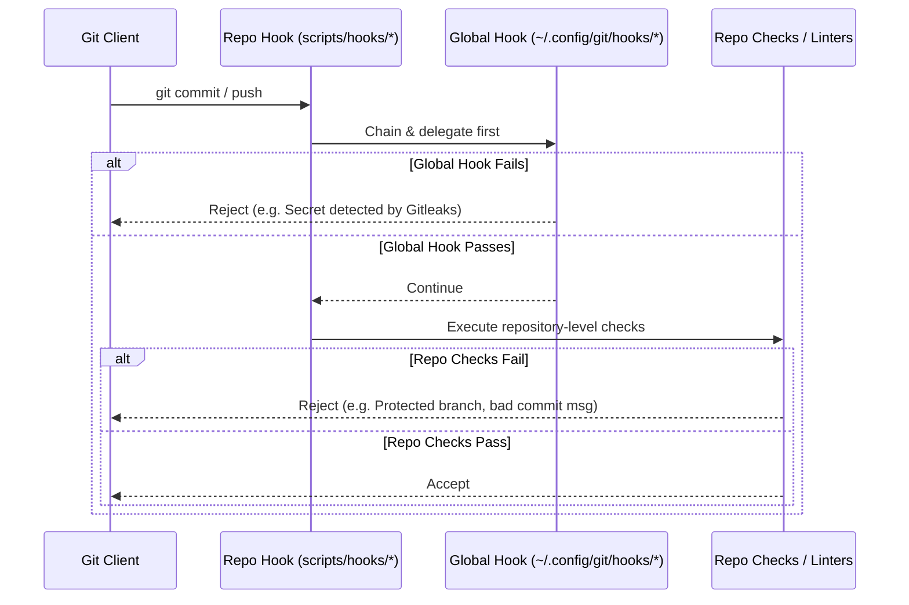

# Tier 2: Portable Project Baseline Specification

This specification documents the reusable repository-level patterns extracted from DevFlow. These patterns can be dropped into any new repository to establish an opinionated, high-assurance development baseline.

---

## 1. Tracked `.gitconfig` Include Pattern

Git cannot track `.git/config` directly. Settings that must survive a fresh clone are checked in as a public-safe root [`.gitconfig`](../templates/repo/.gitconfig) and activated with:

```bash
git config --local include.path ../.gitconfig
```

### Constraints:
1. **Public-Safe:** Never include user-specific names, private key filenames, or absolute home directory paths.
2. **Git Flow Defaults:** Pre-configures the git-flow model (`master = main`, `develop = develop`) so `git flow feature start <name>` works without `git flow init -d` (which defaults to a non-existent `master` branch).
3. **Signing Enforcement:** Enforces `gpg.format = ssh`, `commit.gpgsign = true`, and `tag.gpgsign = true` without specifying the key itself (`user.signingkey` is configured per-contributor).

---

## 2. Two-Tier Hook Chaining & Execution Security (`scripts/hooks/`)

Repositories configure local hooks via `git config core.hooksPath scripts/hooks`. To avoid breaking host security, every repo-local hook adheres to these structural rules:



### The Hook Suite
1. **`commit-msg`**:
   - Validates Conventional Commit format (`<type>(<scope>): <description>`).
   - Refuses subjects ending in a trailing period.
   - Warns when subjects exceed 72 characters.
   - Exempts merge, fixup, and squash commits.
   - Escape hatch: `DEVFLOW_ALLOW_ANY_COMMIT=1`.
2. **`pre-commit`**:
   - Chains to global `~/.config/git/hooks/pre-commit` (running Gitleaks).
   - Refuses direct commits to protected branches (`main`, `develop`).
   - Refuses bashisms in plan `<automated>` blocks that expand to empty strings under zsh (e.g. `${PIPESTATUS[0]}`).
3. **`pre-push`**:
   - **Environment Variable Scrubbing:** Crucial when pushing from linked worktrees. Clears `GIT_DIR`, `GIT_WORK_TREE`, `GIT_INDEX_FILE`, `GIT_OBJECT_DIRECTORY` before running checks. Without this scrub, child processes retarget the root repository rather than their test fixtures.
   - **Release Key Verification:** Verifies that tags or `main` pushes are signed by the maintainer's release key fingerprint, rejecting agent signing keys.
   - **Container Parity Run:** Launches `scripts/check-in-container.sh all`.
4. **`post-commit`**:
   - Non-destructive monitoring: Emits warnings for state drift (e.g., summary landed without state update) but **never modifies tracked files automatically** (which would corrupt git index fences).
5. **Filesystem Mode Invariant (`core.fileMode = false`):**
   - On immutable or cross-platform filesystems where `core.fileMode = false`, running `chmod +x scripts/hooks/*` does not stage executable permissions.
   - **Rule:** Every hook must be recorded in the git index with mode `100755` via:
     ```bash
     git update-index --chmod=+x scripts/hooks/<hook-name>
     ```

---

## 3. Container Parity & Devcontainer Pinning

To eliminate "works on my machine" differences between developer workstations and CI runners:
1. **Exact Image Pinning:** `.devcontainer/devcontainer.json` pins exact image hashes/tags (e.g., `.../rust:2.0.13-1-bookworm`), never floating tags like `latest` or `stable`.
2. **Identical Local & CI Test Drivers:**
   - `scripts/check.sh all`: Local host runner.
   - `scripts/check-in-container.sh all`: Runs `scripts/check.sh` inside the pinned Docker/Podman container locally before pushing.
   - CI runs the exact same checks inside the same container.
3. **Worktree-Aware Container Mounts:**
   - Linked worktrees store `.git` as a file referencing the common directory.
   - Container scripts must bind-mount both the worktree directory and the root git directory (`--git-common-dir`).
4. **Isolated Target Caching:**
   - Container volume names are suffixed with a hash of the project path to prevent cargo fingerprint collisions across parallel checkouts.

---

## 4. High-Assurance CI & Negative Controls

1. **Job Shell Discipline:**
   - Any GitHub Actions job executing inside a container must declare `shell: bash` explicitly. Defaulting to `sh` invokes `dash` in Debian images, silently ignoring `set -o pipefail` and failing closed.
2. **Negative Control Verification:**
   - Every guard or assertion must have a tested failing case. A check that has only been observed passing does not establish discrimination.
   - Decouple deciders from measurers: test assertions against static inputs before running against live state.
