# Universal Development Environment (UDE) — Comprehensive Remediation Plan

This remediation plan organizes all confirmed defects and architectural risks from the external adversarial security review ([reviews/adversarial/review-codex.md](file:///home/denniyahh/Github/universal-dev-env/reviews/adversarial/review-codex.md)) into four parallel, prioritized engineering tracks.

---

## Executive Summary & Milestone Progress

The top 5 P1 critical security and synchronization defects were remediated and verified in commit `26f5d0e`:
* **Defect #1**: Committed tree inspection & secret scanning (`git diff-tree --root`) prevents hook injection and clean-filter leaks prior to push.
* **Defects #2 & #3**: Cache branch isolation (`git checkout -B <branch> origin/<branch>`, `HEAD:refs/heads/<branch>` push, and collision-free PR branch slugs) eliminates PR-to-direct branch desynchronization.
* **Defect #5**: Defense-in-depth symlink traversal protection (`validate_safe_write_target`) prevents writes escaping `local_root`.
* **Defects #6 & #10**: Binary/non-UTF8 file raw byte hashing ensures binary files are not treated as absent, and converged ancestor reconciliation prevents false 3-way merge conflicts.
* **Defect #23**: Safe branch slugging (`sanitize_branch_slug`) prevents uncreated directory failures during lock acquisition on slash-delimited branch names.

The remaining 20 confirmed defects and 7 architectural risks are structured below into concrete phases with clear acceptance criteria and negative controls.

---

## Track 1: Sync Engine & State Hermeticity

### Phase 1.1: Deletion Lifecycle & Propagation (P1)
* **Defect Reference**: Defect #8
* **Problem**: Upstream deletions are classified as `UpstreamModified` but `pull_updates` fails attempting to read the non-existent file. Local deletions similarly fail during `push_updates` mandatory read. When both sides delete an ancestor file, 3-way merge resurrects it as an empty file (`Some("")`).
* **Implementation Scope**:
  1. Expand `SyncStatus` to include `LocalDeleted`, `UpstreamDeleted`, and `BothDeleted`.
  2. In `scan_project`, detect deletion when `local_hash.is_none() && ancestor_hash.is_some()`.
  3. In `pull_updates`, handle `UpstreamDeleted`: safely delete the local managed file and remove its record from `.ude/state.json`.
  4. In `push_updates`, handle `LocalDeleted`: delete the upstream template and record the deletion.
  5. In `merge::merge_3way_text`, distinguish absent file from empty file; return clean deletion when both sides delete.
* **Verification & Negative Controls**:
  - Test upstream deletion deletes local file on pull without `ENOENT`.
  - Test local deletion propagates upstream on push.
  - Test simultaneous deletion removes file and updates state without creating an empty 0-byte file.
  - Negative control: Upstream delete vs local edit must produce `Conflicted`.

### Phase 1.2: Transactional Materialization & Atomic State Journaling (P1)
* **Defect Reference**: Defect #7, Suspected Risk #4, #5
* **Problem**: `pull_updates` and `push_updates` write files sequentially to disk before updating `.ude/state.json`. If a write fails halfway (e.g. disk full, permission denied, directory collision), modified files remain on disk while `.ude/state.json` retains the old ancestor, desynchronizing the workspace.
* **Implementation Scope**:
  1. Implement two-phase commit: write new contents to temporary files (`<target>.tmp.<pid>`) in the same filesystem directory.
  2. Atomically rename temporary files over target paths (`fs::rename`).
  3. If any file preparation fails, clean up all temporary files and abort before replacing any target file.
  4. Update `.ude/state.json` atomically via atomic rename of `.ude/state.json.tmp`.
* **Verification & Negative Controls**:
  - Test write failure on file 2 of 3 leaves file 1 completely unmodified.
  - Test crash simulation leaves `.ude/state.json` intact.

### Phase 1.3: Merge Candidate Push Handling & Line Ending Fidelity (P2)
* **Defect Reference**: Defect #9, Defect #25
* **Problem**: Orthogonal edits classified as `Merged` are silently ignored by `push_updates`, reporting success while syncing 0 files. Text merge splits on `\n` and joins with `\n`, silently stripping Windows CRLF (`\r\n`) line endings.
* **Implementation Scope**:
  1. In `push_updates`, explicitly handle `SyncStatus::Merged`: either materialize and push the validated merged content, or abort with `PushResult::ConflictBlocked` instructing the operator to run `ude sync pull` first.
  2. In `merge_3way_text`, detect whether the base file used `\r\n` or `\n`; preserve the dominant line ending in the merged output. Preserve intentional final newlines.
* **Verification & Negative Controls**:
  - Test push with `Merged` file produces explicit, actionable output (no silent 0-synced success).
  - Test CRLF file with orthogonal edits merges and retains `\r\n` line endings.
  - Negative control: LF file must not acquire carriage returns.

### Phase 1.4: Structured Conflict Artifacts (`.conflict`) (P2)
* **Defect Reference**: Defect #27
* **Problem**: Specification promises `.conflict` report generation on conflicted pulls, but `pull_updates` halts on the first conflicted file without writing diff artifacts or diagnostic details.
* **Implementation Scope**:
  1. On `Conflicted` pull, gather ALL conflicting files across the project (not just the first one).
  2. Write `<target>.conflict` containing a 3-way diff block:
     ```diff
     <<<<<<< LOCAL
     ... local content ...
     ||||||| ANCESTOR
     ... ancestor content ...
     =======
     ... upstream content ...
     >>>>>>> UPSTREAM
     ```
  3. Include actionable CLI instructions in stderr pointing to the generated `.conflict` files.
* **Verification & Negative Controls**:
  - Test pull on two conflicted files generates `.conflict` artifacts for both.
  - Negative control: Clean pull must never leave `.conflict` artifacts.

### Phase 1.5: Cross-Platform Subprocess & Lock Isolation (P2)
* **Defect Reference**: Defect #24, Suspected Risks #1, #2, #3
* **Problem**: Lock contention check relies on numeric errno 11 (Linux-specific `EAGAIN`/`EWOULDBLOCK`). Subprocesses lack execution deadlines. Inherited `GIT_DIR`/`GIT_INDEX_FILE` can contaminate commands.
* **Implementation Scope**:
  1. Replace raw errno matching with `std::io::Error::last_os_error().kind() == std::io::ErrorKind::WouldBlock`.
  2. Implement bounded execution timeouts for all Git and `gh` subprocess calls.
  3. Scrub inherited git environment variables (`GIT_DIR`, `GIT_WORK_TREE`, `GIT_INDEX_FILE`, `GIT_CONFIG`) on all spawned commands.
* **Verification & Negative Controls**:
  - Test lock timeout when another thread holds lock.
  - Test running sync inside a repository with `GIT_DIR=/tmp/other` does not corrupt `/tmp/other`.

---

## Track 2: Sanitizer, Boundaries & Security

### Phase 2.1: Credential Alphabets & Entropy Guardrails (P1)
* **Defect Reference**: Defect #4
* **Problem**: Secret detection regex `[A-Za-z0-9_\-\.]{20,}` fails on valid credential alphabets containing `+`, `/`, `=`, or URL-safe separators. The documented high-entropy check is missing from the implementation.
* **Implementation Scope**:
  1. Expand token regex to include standard Base64 characters (`[A-Za-z0-9_\-\.\+/=]{20,}`).
  2. Implement Shannon entropy calculation function `calculate_shannon_entropy(s: &str) -> f64`.
  3. Flag strings >= 20 characters with Shannon entropy > 4.2 as potential high-entropy credentials.
  4. Parse common configuration formats (TOML, YAML, JSON, INI) to inspect raw scalar values directly.
* **Verification & Negative Controls**:
  - Test tokens starting with `+` or containing `/` are blocked.
  - Test high-entropy base64 strings trigger `SecretDetected`.
  - Negative control: Low-entropy natural English phrases or UUIDs must pass clean.

### Phase 2.2: Path Parameterization Punctuation & Variable Alignment (P2)
* **Defect Reference**: Defect #22
* **Problem**: Path parameterization regex excludes closing parentheses `)`, semicolons `;`, commas `,`, and brackets, leaving `(/home/alice)` unparameterized. Emits `{{ user.xdg_config }}` while architecture doc specifies `{{ xdg.config }}`.
* **Implementation Scope**:
  1. Update path parameterization boundary regex to: `([/\\"'\s:,;()\[\]<>]|$)`.
  2. Align template variable namespace across `TemplateContext` and documentation: provide both `{{ xdg.config }}` and `{{ user.xdg_config }}` for backward compatibility.
* **Verification & Negative Controls**:
  - Test `(/home/user/path)` parameterizes to `({{ user.home }}/path)`.
  - Test `"/home/user/path",` parameterizes cleanly.

### Phase 2.3: TypeSafe System One Hardening & Boundary Defense (P2)
* **Defect Reference**: Defect #12, Defect #13, Suspected Risk #6
* **Problem**: Zero-confidence answers authorize publication. Private/overridden rules are transmitted to the external API before checking whether the file will even be published. Upstream original is sent without local secret pre-scanning.
* **Implementation Scope**:
  1. Enforce strict confidence threshold in `TypeSafeClient`: reject or mark `Uncertain` any response with `confidence < 0.85` or margin between top two labels < 0.20.
  2. Filter out overridden files (`*.local.*`, `.ude/overrides/`) BEFORE invoking TypeSafe API.
  3. Run local secret scanning on BOTH candidate local text AND upstream baseline text before API transmission.
  4. Avoid passing API key in process command arguments; pass via stdin or standard authorization headers.
* **Verification & Negative Controls**:
  - Test mock response with confidence 0.0 or ambiguous probabilities (0.34 vs 0.33) fails closed.
  - Test overridden rule file is never transmitted to external API.
  - Negative control: High confidence (0.95) benign rephrase succeeds.

---

## Track 3: Doctor & CLI Hardening

### Phase 3.1: Strict SSH Signer Parsing & Key Validation (P1)
* **Defect Reference**: Defect #14
* **Problem**: `audit_allowed_signers` merely tests whether the file contains the substring `"ssh-ed25519"`, accepting garbage strings like `garbage ssh-ed25519 garbage`.
* **Implementation Scope**:
  1. Implement strict allowed-signers line parser:
     `[email/principal] [key-type] [base64-encoded-public-key] [optional-comment]`
  2. Validate that `key-type` is supported (`ssh-ed25519`, `ecdsa-sha2-nistp256`, `rsa-sha2-512`).
  3. Validate base64 decoding and exact byte length (e.g. 32 bytes for ed25519 public key).
  4. Ensure distinct identities for maintainer key vs agent key.
* **Verification & Negative Controls**:
  - Test valid ed25519 line passes.
  - Test line with invalid base64 or missing email fails doctor with code 2.
  - Negative control: Test garbage string containing `"ssh-ed25519"` fails closed.

### Phase 3.2: Dual Index & Disk Executable Bit Verification (P2)
* **Defect Reference**: Defect #15
* **Problem**: Doctor checks git index mode `100755` but ignores on-disk permissions. A hook tracked as `100755` but mode `0644` on disk passes doctor, yet Git skips it during commit.
* **Implementation Scope**:
  1. In `audit_hooks_permissions`, inspect BOTH:
     - Git index mode (`git ls-files -s scripts/hooks/<name>` == `100755`).
     - On-disk filesystem permissions (`fs::symlink_metadata(path).permissions().mode() & 0o111 != 0`).
  2. If either is missing, report `CheckStatus::Fail`.
* **Verification & Negative Controls**:
  - Test hook with `100755` index and `0755` disk passes.
  - Test hook with `100755` index but `0644` disk fails doctor.
  - Test untracked executable hook fails doctor (must be tracked in repo).

### Phase 3.3: Effective Git Configuration & Relative Include Resolution (P2)
* **Defect Reference**: Defect #16
* **Problem**: Doctor checks raw string `include.path` matching `.gitconfig` or `../.gitconfig`. Relative paths resolve relative to the file defining them (`.git/config`), so `include.path = .gitconfig` looks inside `.git/` rather than the repository root.
* **Implementation Scope**:
  1. Query effective git configuration via `git config --get-all include.path`.
  2. Resolve path relative to containing config file parent:
     - For `.git/config`: relative paths resolve against `.git/`. Correct link to root is `../.gitconfig`.
  3. Verify that git actually loads settings defined in root `.gitconfig` (e.g. `git config core.excludesfile`).
* **Verification & Negative Controls**:
  - Test `include.path = ../.gitconfig` passes.
  - Test `include.path = .gitconfig` in `.git/config` fails.

### Phase 3.4: Strict Exit Code Contract Aggregation (P2)
* **Defect Reference**: Defect #17
* **Problem**: `DoctorReport::has_failures` only checks `Fail` and `Critical`, ignoring `Warning`. Missing non-critical items exit 0, violating the specification contract:
  - `0`: All passed
  - `1`: One or more warnings
  - `2`: Critical security failure
* **Implementation Scope**:
  1. Update `DoctorReport::exit_code(&self) -> i32`:
     - If any `Critical`: return 2.
     - If any `Fail`: return 1.
     - If any `Warning`: return 1.
     - Otherwise: return 0.
  2. Update CLI exit handling in `main.rs`.
* **Verification & Negative Controls**:
  - Test clean doctor run exits 0.
  - Test doctor run with 1 warning exits 1.
  - Test doctor run with critical failure exits 2.

---

## Track 4: Templates, Archetypes & Manifest

### Phase 4.1: Archetype Decoupling & Personal Workflow Removal (P1)
* **Defect Reference**: Defect #20
* **Problem**: Portable template files contain references to personal repository forks (`denniyahh/gsd-core`), missing Mac scripts (`ci-mac.sh`), and non-existent tools (`check-workflow-budgets.sh`).
* **Implementation Scope**:
  1. Remove hardcoded personal URLs and references from `templates/projects/agents/agents.md.jinja`.
  2. In `templates/projects/agents/mise.toml.jinja`, parameterize workflow tasks per archetype:
     - Rust: `cargo test`, `cargo clippy`.
     - Node: `npm test`, `npm run lint`.
     - Generic: Posix shell standard commands.
  3. Remove references to `ci-mac.sh` and missing scripts. Ensure all referenced executables are included in the template store.
* **Verification & Negative Controls**:
  - Test `init` on node archetype produces `npm test` tasks without references to Cargo or `ci-mac.sh`.
  - Ripgrep clean check: zero occurrences of `denniyahh` in `templates/`.

### Phase 4.2: Safe Project Re-Initialization & Asset Validation (P1)
* **Defect Reference**: Defect #18, Defect #19
* **Problem**: Missing template assets during `init` exit 0 without generating files. Re-running `init` blindly overwrites existing customized files (`mise.toml`, hooks) and erases `.ude/state.json` ancestry history.
* **Implementation Scope**:
  1. Validate all required archetype assets exist before writing anything; fail loudly with descriptive error if template asset missing.
  2. If project is already initialized:
     - Refuse to overwrite modified managed files unless `--force` is specified.
     - Preserve existing ancestor records in `.ude/state.json`.
     - Run 3-way merge on modified files when refreshing templates.
* **Verification & Negative Controls**:
  - Test `init` with missing template store aborts with non-zero exit code.
  - Test running `init` twice preserves user modifications in `mise.toml`.

### Phase 4.3: Strict Jinja Variable Handling & Scan Error Propagation (P2)
* **Defect Reference**: Defect #26
* **Problem**: Missing template variables succeed silently in `minijinja`. Render errors during `scan_project` fall back to raw unrendered template strings, corrupting diff comparisons.
* **Implementation Scope**:
  1. Configure `minijinja::Environment` with strict behavior: error on undefined variables.
  2. In `scan_project`, if template rendering fails due to missing variables or syntax errors:
     - Fail the scan or report `SyncStatus::Conflicted` with render failure diagnostic.
     - Never silently use raw unrendered `{{ var }}` strings as upstream content.
* **Verification & Negative Controls**:
  - Test template with undefined variable fails rendering.
  - Test scan propagates template render error rather than treating unrendered template as content.

### Phase 4.4: Manifest Policy Enforcement (`.ude.toml`) (P2)
* **Defect Reference**: Defect #11, Defect #21
* **Problem**: Manifest configuration fields (`exclude`, `allow_overrides`, `strategy`, `auto_pr`) are parsed but ignored during execution. Malformed `.ude.toml` silently falls back to defaults without error.
* **Implementation Scope**:
  1. Fail loudly on syntax or validation errors in `.ude.toml`.
  2. Wire `manifest.sync.exclude` into `scan_project` file filters.
  3. Wire `manifest.sync.auto_pr` into `push_updates` / `push_to_remote` so PR mode is default when configured.
  4. Align `SyncConfig::default()` so field defaults match omitted sections.
* **Verification & Negative Controls**:
  - Test invalid `.ude.toml` causes `ude` commands to abort with exit 1.
  - Test `auto_pr = true` in manifest routes direct `ude sync push` to PR workflow automatically.

---

## Implementation Sequence & Dependencies

```mermaid
flowchart TD
    subgraph Track1 ["Track 1: Sync Engine"]
        T1_1["Phase 1.1: Deletion Lifecycle"] --> T1_2["Phase 1.2: Transactional Materialization"]
        T1_2 --> T1_3["Phase 1.3: Merge & CRLF Fidelity"]
        T1_3 --> T1_4["Phase 1.4: Conflict Artifacts"]
        T1_4 --> T1_5["Phase 1.5: Cross-Platform Subprocesses"]
    end

    subgraph Track2 ["Track 2: Sanitizer & Security"]
        T2_1["Phase 2.1: Credential Alphabets & Entropy"] --> T2_2["Phase 2.2: Punctuation Boundaries"]
        T2_2 --> T2_3["Phase 2.3: TypeSafe System One Hardening"]
    end

    subgraph Track3 ["Track 3: Doctor & CLI Hardening"]
        T3_1["Phase 3.1: Strict SSH Signer Parsing"] --> T3_2["Phase 3.2: Dual Index/Disk Permissions"]
        T3_2 --> T3_3["Phase 3.3: Relative Include Resolution"]
        T3_3 --> T3_4["Phase 3.4: Exit Code Aggregation"]
    end

    subgraph Track4 ["Track 4: Templates & Manifest"]
        T4_1["Phase 4.1: Archetype Decoupling"] --> T4_2["Phase 4.2: Safe Re-Init & Validation"]
        T4_2 --> T4_3["Phase 4.3: Strict Jinja Variables"]
        T4_3 --> T4_4["Phase 4.4: Manifest Policy Wiring"]
    end
```



Every phase must be delivered with negative controls and verified against `cargo test` and `cargo clippy --workspace --all-targets -- -D warnings`.
